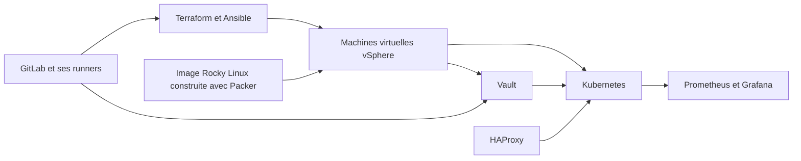

# SLLYM — Concevoir et exploiter une plateforme hybride

Projet de fin d’études réalisé en équipe à l’ESGI. Le projet relie une infrastructure virtualisée, un cluster Kubernetes, un service GitLab et une gestion centralisée des secrets. Kubernetes sert de fil conducteur pour comprendre les choix de déploiement, de sécurité et d’exploitation.

Ce dépôt est le point d’entrée du portfolio. Les extraits techniques se trouvent dans les dépôts indiqués ci-dessous.

## Trois choix d’architecture

| Besoin | Approche | Dépôt et extrait |
| --- | --- | --- |
| Intervenir sur un nœud du cluster | Vérifier les nœuds et protéger le quorum d’etcd, la base qui conserve l’état de Kubernetes. | [Kubernetes sur vSphere](https://github.com/y-rhb/kubernetes-vsphere) · Rôles Ansible de contrôle de santé, de mise en maintenance et de retrait d’un membre. |
| Mettre Vault en service | Initialiser Vault avant d’activer les pipelines qui l’utilisent. Garder stable l’adresse d’accès au service lors d’une bascule. | [Vault HA](https://github.com/y-rhb/vault-ha) · Sondes Keepalived qui distinguent l’état de santé du rôle du nœud. |
| Séparer les accès | Distinguer la répartition de charge interne et le point d’entrée exposé. | [HAProxy pour Kubernetes](https://github.com/y-rhb/haproxy-kubernetes) · Points d’entrée interne et DMZ, sondes de bascule et intégration d’un pare-feu applicatif. |

## Comment les briques s’articulent

Packer construit l’image Rocky Linux. Terraform la clone sur vSphere et Ansible configure les machines. Kubernetes et HAProxy réutilisent le même module Terraform de machines virtuelles. Vault, GitLab et GitLab Runner embarquent chacun leur propre module dans les versions présentées. Dans Kubernetes, Prometheus collecte les métriques et Grafana les rend lisibles dans des tableaux de bord. Les autres dépôts montrent la construction de l’image ([Packer et Rocky Linux](https://github.com/y-rhb/packer-rocky-linux)), la préparation de GitLab ([GitLab sur vSphere](https://github.com/y-rhb/gitlab-vsphere)) et celle du runner ([GitLab Runner sur vSphere](https://github.com/y-rhb/gitlab-runner-vsphere)).

## Contribution et périmètre

Yanis Rahab a participé à ce projet d’équipe. Ses contributions comprennent la sonde de suivi du nœud actif Vault, la validation des configurations HAProxy et la préparation des outils du runner GitLab. Il a également présenté le démarrage initial de Vault et le diagnostic d’une double écoute HAProxy. Les sélections techniques servent à expliquer les réalisations du projet. Les conditions de déploiement dépendent de l’environnement cible.
